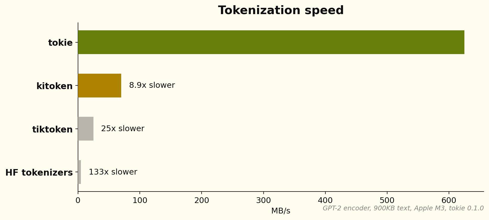
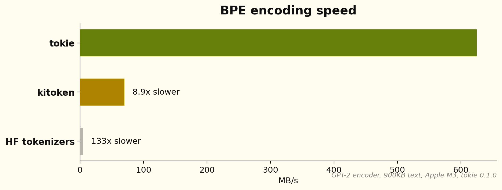
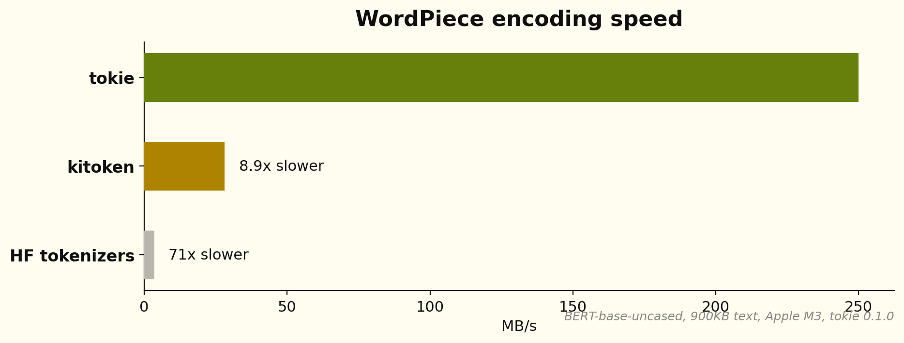
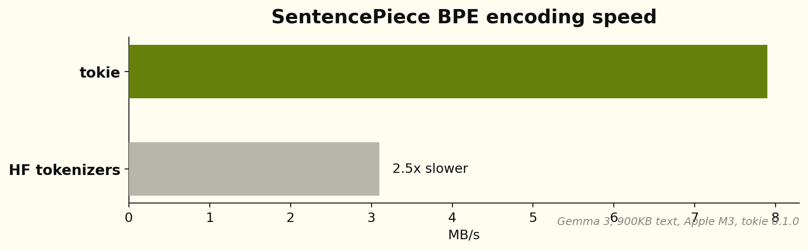
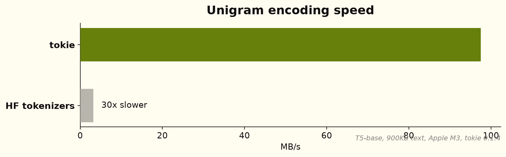
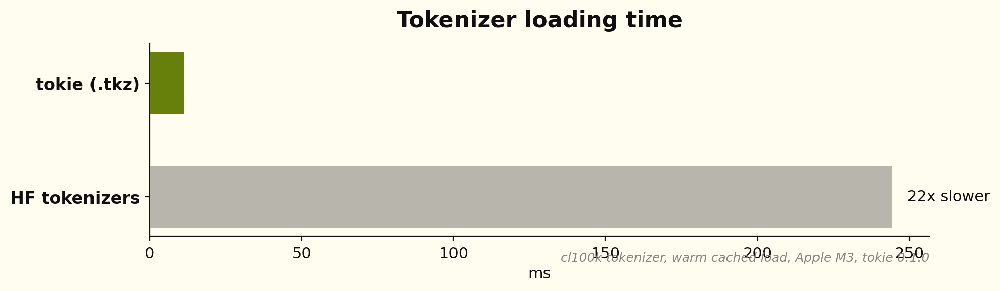

<div align="center">


# tokie

[](https://crates.io/crates/tokie)
[](https://pypi.org/project/tokie/)
[](https://crates.io/crates/tokie)
[](https://pypi.org/project/tokie/)
[](LICENSE-MIT)
[](https://docs.rs/tokie)
[](https://github.com/chonkie-inc/tokie)

*25 to 150 times faster than Hugging Face tokenizers, with the same token ids*

[Install](#install) •
[Quick start](#quick-start) •
[Examples](#examples) •
[Benchmarks](#benchmarks) •
[Why tokie?](#why-tokie)

</div>

> [!CAUTION]
> tokie is in its alpha stage and might produce mis-aligned output. Please report any issues you encounter.

tokie is a Rust tokenizer library with Python bindings. It loads a Hugging Face `tokenizer.json` and encodes 25 to 150 times faster than Hugging Face tokenizers. It implements BPE, WordPiece, SentencePiece, and Unigram. The token ids match Hugging Face tokenizers.



## Install

### Python

```bash
pip install tokie
```

### Rust

```toml
[dependencies]
tokie = { version = "0.0.8", features = ["hf"] }
```

Coming from Hugging Face `tokenizers`? See the [migration guide](docs/MIGRATION.md).

## Quick start

### Python

```python
import tokie

# Load a Hugging Face tokenizer
tokenizer = tokie.Tokenizer.from_pretrained("bert-base-uncased")

# Encode. Returns an Encoding with ids, attention_mask, type_ids, and tokens.
encoding = tokenizer("Hello, world!")  # or tokenizer.encode("Hello, world!")
print(encoding.ids)             # [101, 7592, 1010, 2088, 999, 102]
print(encoding.tokens)          # ['[CLS]', 'hello', ',', 'world', '!', '[SEP]']
print(encoding.attention_mask)  # [1, 1, 1, 1, 1, 1]

# Decode
text = tokenizer.decode(encoding.ids)  # "hello , world !"

# Count tokens without allocating
count = tokenizer.count_tokens("Hello, world!")  # 6

# Batch encode (parallel across all cores)
encodings = tokenizer.encode_batch(["Hello!", "World"], add_special_tokens=True)
```

### Rust

```rust
use tokie::Tokenizer;

let tokenizer = Tokenizer::from_pretrained("bert-base-uncased")?;
let encoding = tokenizer.encode("Hello, world!", true);
println!("{:?}", encoding.ids);             // [101, 7592, 1010, 2088, 999, 102]
println!("{:?}", encoding.attention_mask);  // [1, 1, 1, 1, 1, 1]

let text = tokenizer.decode(&encoding.ids).unwrap();
```

## Examples

### Padding and truncation

Model input is a fixed length. tokie pads and truncates the same way Hugging Face tokenizers does:

```python
tokenizer = tokie.Tokenizer.from_pretrained("bert-base-uncased")

# Truncate to max length
tokenizer.enable_truncation(max_length=128)

# Pad to fixed length (or use BatchLongest for dynamic padding)
tokenizer.enable_padding(length=128, pad_id=0)

# All outputs are now exactly 128 tokens
results = tokenizer.encode_batch(["Short text", "A much longer piece of text for testing"])
assert all(len(r) == 128 for r in results)

# attention_mask shows which tokens are real (1) vs padding (0)
print(results[0].attention_mask)  # [1, 1, 1, 1, 0, 0, 0, ...]
```

### Cross-encoder pair encoding

Rerankers and cross-encoders take a sentence pair and token type ids:

```python
pair = tokenizer("How are you?", "I am fine.")  # or tokenizer.encode_pair(...)
pair.ids               # [101, 2129, 2024, 2017, 1029, 102, 1045, 2572, 2986, 1012, 102]
pair.attention_mask    # [1, 1, 1, 1, 1, 1, 1, 1, 1, 1, 1]
pair.type_ids          # [0, 0, 0, 0, 0, 0, 1, 1, 1, 1, 1]
pair.special_tokens_mask  # [1, 0, 0, 0, 0, 1, 0, 0, 0, 0, 1]
```

### Byte offsets

Each token records the byte range it came from:

```python
enc = tokenizer.encode_with_offsets("Hello world")
for token_id, (start, end) in zip(enc.ids, enc.offsets):
    print(f"  token {token_id}: bytes [{start}:{end}]")
```

### Vocabulary access

```python
tokenizer.vocab_size          # 30522
tokenizer.id_to_token(101)    # "[CLS]"
tokenizer.token_to_id("[SEP]")  # 102
vocab = tokenizer.get_vocab()   # {"[CLS]": 101, "[SEP]": 102, ...}
```

### Save and load `.tkz` files

The `.tkz` file is about 10 times smaller than `tokenizer.json` and loads in about 5 ms:

```python
tokenizer.save("model.tkz")
tokenizer = tokie.Tokenizer.from_file("model.tkz")
```

`from_pretrained()` tries `.tkz` first, then `tokenizer.json`.

### Bulk file encoding

`encode_files` reads the files in Rust, splits on a separator, and encodes every document on all cores. The text stays in Rust. It returns a flat `uint32` array of token ids and a `uint64` array of per-document offsets. NumPy reads both arrays without a copy:

```python
ids, offsets = tokenizer.encode_files(["corpus.txt"], separator=b"<|endoftext|>")
# ids: np.ndarray[uint32], every token, concatenated
# offsets: np.ndarray[uint64], length ndocs+1. Doc i is ids[offsets[i]:offsets[i+1]].

n_tokens = tokenizer.count_tokens_files(["corpus.txt"], separator=b"<|endoftext|>")
```

The ids match `encode_batch_flat` on the same documents. Invalid UTF-8 is kept as bytes and does not raise.

## Benchmarks

All benchmarks run on an Apple M3 with tokie 0.1.3. The ids match Hugging Face tokenizers.

### BPE encoding (GPT-2, Llama, Qwen, ModernBERT)

For tiktoken-style BPE, tokie uses a backtracking encoder on an Aho-Corasick automaton. It takes a greedy longest match in O(n), and it backtracks only when two adjacent tokens are not a valid pair. It does not merge one byte pair at a time. Pretokenization is the SIMD mask scanner in [pretokie](https://crates.io/crates/pretokie). That scanner classifies 64-byte blocks into piece-boundary bitmasks and runs above 1 GB/s per core. A repeated piece hits a per-worker cache instead of running BPE again. Work stealing splits the text so every core has a chunk. On one string this is 39 to 154 times faster than Hugging Face tokenizers.



### WordPiece (BERT, MiniLM, BGE, GTE)

WordPiece searches a vocabulary trie for the longest prefix. tokie stores that trie as a Double-Array trie and looks it up in O(n), with a BERT pretokenizer. On BERT this is 25 to 71 times faster than Hugging Face tokenizers, and the ids match.



### SentencePiece BPE and Unigram (Gemma, XLM-R, T5)

SentencePiece BPE merges in an order that is not topological. tokie uses a radix heap. Insert and pop are O(1) amortized because a later BPE rank is never smaller. On Gemma 3 this is 2 to 3 times faster than Hugging Face tokenizers.

Unigram models such as T5, XLM-RoBERTa, and ALBERT run Viterbi on each metaspace-delimited word and store the frequent units. Encoding one string is about 4 times faster than whole-string Viterbi. Batch encoding is about 3 times faster. The ids match. A vocabulary with a metaspace inside a token uses whole-string Viterbi.





### Python benchmarks

All results on Apple M3, single-string encode, median of 10 runs.

#### tokie vs Hugging Face tokenizers

| Model | Text size | tokie | Hugging Face | Speedup |
|-------|-----------|-------|---------------|-------|
| BERT | 45 KB | 0.38 ms | 9.6 ms | **25x** |
| BERT | 900 KB | 3.60 ms | 257 ms | **71x** |
| GPT-2 | 45 KB | 0.13 ms | 8.6 ms | **65x** |
| GPT-2 | 900 KB | 1.44 ms | 191 ms | **133x** |
| Llama 3 | 45 KB | 0.22 ms | 8.6 ms | **39x** |
| Llama 3 | 900 KB | 2.49 ms | 195 ms | **78x** |
| Qwen 3 | 45 KB | 0.13 ms | 9.1 ms | **68x** |
| Qwen 3 | 900 KB | 1.36 ms | 210 ms | **154x** |
| ModernBERT | 45 KB | 0.15 ms | 9.3 ms | **62x** |
| ModernBERT | 900 KB | 1.42 ms | 211 ms | **149x** |
| Gemma 3 | 45 KB | 4.54 ms | 9.7 ms | **2x** |
| Gemma 3 | 900 KB | 114 ms | 289 ms | **3x** |

#### tokie vs tiktoken (OpenAI models)

| Model | Text size | tokie | tiktoken | Speedup |
|-------|-----------|-------|----------|---------|
| cl100k (GPT-4) | 45 KB | 0.13 ms | 2.12 ms | **17x** |
| cl100k (GPT-4) | 900 KB | 1.28 ms | 42.3 ms | **33x** |
| o200k (GPT-4o) | 45 KB | 0.16 ms | 3.57 ms | **22x** |
| o200k (GPT-4o) | 900 KB | 1.66 ms | 70.7 ms | **42x** |

The ids match on every model in these tables. Batch encoding is 17 to 36 times faster than Hugging Face tokenizers. `encode_batch_flat` returns one contiguous NumPy array.

### Tokenizer loading

Loading `tokenizer.json` parses the JSON, builds the vocabulary, and, for BPE, builds the Aho-Corasick automaton. tiktoken parses its BPE data and compiles its regexes on every load. A `.tkz` file stores the Double-Array Aho-Corasick state, the normalized vocabulary, the encoder configuration, and, since v13, the added and special tokens. Loading that file is deserialization. `from_pretrained` reads the hub disk cache before the network and writes the compiled `.tkz` next to the snapshot, so a warm load does not use the network. A warm load is 13 to 44 times faster than Hugging Face tokenizers. BERT takes 2.8 ms. GPT-2 takes 6.2 ms.

| Model | tokie | Hugging Face | Speedup |
|-------|-------|---------------|---------|
| BERT | 2.8 ms | 123 ms | **44x** |
| GPT-2 | 6.2 ms | 151 ms | **24x** |
| Llama 3.2 | 10.6 ms | 261 ms | **25x** |
| cl100k | 11.1 ms | 244 ms | **22x** |
| o200k | 23.2 ms | 310 ms | **13x** |



## Verified tokenizers

Every tokenizer below is tested against the Hugging Face tokenizer on 1 MB of [enwik8](https://mattmahoney.net/dc/textdata.html), about 300,000 tokens, in [CI](../../actions/workflows/tokenizer-accuracy.yml). Pass means every token matches.

The full matrix is in [docs/TOKENIZERS.md](docs/TOKENIZERS.md).

<details>
<summary>Full accuracy table, 74 models</summary>

| Model | Type | Status |
|-------|------|--------|
| [GPT-2](https://huggingface.co/tokiers/gpt2) | BPE | Pass |
| [cl100k](https://huggingface.co/tokiers/cl100k) | BPE | Pass, compared with tiktoken-rs |
| [o200k](https://huggingface.co/tokiers/o200k) | BPE | Pass, compared with tiktoken-rs |
| [RoBERTa](https://huggingface.co/tokiers/roberta-base) | BPE | Pass |
| [Phi-2](https://huggingface.co/tokiers/phi-2) | BPE | Pass |
| [Phi-3 Mini](https://huggingface.co/tokiers/Phi-3-mini-4k-instruct) | BPE | Pass |
| [ModernBERT](https://huggingface.co/tokiers/ModernBERT-base) | BPE | Pass |
| [CodeLlama 7B](https://huggingface.co/tokiers/CodeLlama-7b-hf) | BPE | Pass |
| [DeepSeek-V3](https://huggingface.co/tokiers/DeepSeek-V3) | BPE | Pass |
| [DeepSeek-R1](https://huggingface.co/tokiers/DeepSeek-R1) | BPE | Pass |
| [Gemma 2 2B](https://huggingface.co/tokiers/gemma-2-2b) | SentencePiece BPE | Pass |
| [Gemma 3 4B](https://huggingface.co/tokiers/gemma-3-4b-it) | SentencePiece BPE | Pass |
| [Llama 3.2 1B](https://huggingface.co/tokiers/Llama-3.2-1B) | BPE | Pass |
| [Llama 4 Scout](https://huggingface.co/tokiers/Llama-4-Scout-17B-16E) | BPE | Pass |
| [Mistral 7B](https://huggingface.co/tokiers/Mistral-7B-v0.1) | BPE | Pass |
| [Mistral Nemo](https://huggingface.co/tokiers/Mistral-Nemo-Base-2407) | BPE | Pass |
| [Mixtral 8x7B](https://huggingface.co/tokiers/Mixtral-8x7B-v0.1) | BPE | Pass |
| [NV-Embed-v2](https://huggingface.co/tokiers/NV-Embed-v2) | SentencePiece BPE | Pass |
| [Qwen2 7B](https://huggingface.co/tokiers/Qwen2-7B) | BPE | Pass |
| [Qwen3 Embed 0.6B](https://huggingface.co/tokiers/Qwen3-Embedding-0.6B) | BPE | Pass |
| [Qwen3 Embed 4B](https://huggingface.co/tokiers/Qwen3-Embedding-4B) | BPE | Pass |
| [Qwen3 Embed 8B](https://huggingface.co/tokiers/Qwen3-Embedding-8B) | BPE | Pass |
| [Qwen3 0.6B](https://huggingface.co/tokiers/Qwen3-0.6B) | BPE | Pass |
| [Qwen3 8B](https://huggingface.co/tokiers/Qwen3-8B) | BPE | Pass |
| [Qwen3 Coder 30B](https://huggingface.co/tokiers/Qwen3-Coder-30B-A3B-Instruct) | BPE | Pass |
| [Qwen3.5 0.8B](https://huggingface.co/tokiers/Qwen3.5-0.8B) | BPE | Pass |
| [Qwen3.5 4B](https://huggingface.co/tokiers/Qwen3.5-4B) | BPE | Pass |
| [SmolLM2 135M](https://huggingface.co/tokiers/SmolLM2-135M) | BPE | Pass |
| [StableLM 2 1.6B](https://huggingface.co/tokiers/stablelm-2-1_6b) | BPE | Pass |
| [Nomic Embed v1](https://huggingface.co/tokiers/nomic-embed-text-v1) | WordPiece | Pass |
| [BERT base](https://huggingface.co/tokiers/bert-base-uncased) | WordPiece | Pass |
| [all-MiniLM-L6-v2](https://huggingface.co/tokiers/all-MiniLM-L6-v2) | WordPiece | Pass |
| [all-MiniLM-L12-v2](https://huggingface.co/tokiers/all-MiniLM-L12-v2) | WordPiece | Pass |
| [all-mpnet-base-v2](https://huggingface.co/tokiers/all-mpnet-base-v2) | WordPiece | Pass |
| [BGE base en v1.5](https://huggingface.co/tokiers/bge-base-en-v1.5) | WordPiece | Pass |
| [BGE large en v1.5](https://huggingface.co/tokiers/bge-large-en-v1.5) | WordPiece | Pass |
| [BGE small en v1.5](https://huggingface.co/tokiers/bge-small-en-v1.5) | WordPiece | Pass |
| [BGE en ICL](https://huggingface.co/tokiers/bge-en-icl) | BPE | Pass |
| [BGE M3](https://huggingface.co/tokiers/bge-m3) | SentencePiece BPE | Pass |
| [E5 base v2](https://huggingface.co/tokiers/e5-base-v2) | WordPiece | Pass |
| [E5 large v2](https://huggingface.co/tokiers/e5-large-v2) | WordPiece | Pass |
| [E5 small v2](https://huggingface.co/tokiers/e5-small-v2) | WordPiece | Pass |
| [GTE base](https://huggingface.co/tokiers/gte-base) | WordPiece | Pass |
| [GTE large](https://huggingface.co/tokiers/gte-large) | WordPiece | Pass |
| [GTE small](https://huggingface.co/tokiers/gte-small) | WordPiece | Pass |
| [GTE Qwen2 7B](https://huggingface.co/tokiers/gte-Qwen2-7B-instruct) | BPE | Pass |
| [MS MARCO MiniLM L-4](https://huggingface.co/tokiers/ms-marco-MiniLM-L-4-v2) | WordPiece | Pass |
| [MS MARCO MiniLM L-6](https://huggingface.co/tokiers/ms-marco-MiniLM-L-6-v2) | WordPiece | Pass |
| [mxbai embed large v1](https://huggingface.co/tokiers/mxbai-embed-large-v1) | WordPiece | Pass |
| [mxbai embed 2d large v1](https://huggingface.co/tokiers/mxbai-embed-2d-large-v1) | WordPiece | Pass |
| [mxbai embed xsmall v1](https://huggingface.co/tokiers/mxbai-embed-xsmall-v1) | WordPiece | Pass |
| [deepset mxbai embed de large](https://huggingface.co/tokiers/deepset-mxbai-embed-de-large-v1) | Unigram | Pass |
| [Jina v2 base en](https://huggingface.co/tokiers/jina-embeddings-v2-base-en) | BPE | Pass |
| [Jina v2 base code](https://huggingface.co/tokiers/jina-embeddings-v2-base-code) | BPE | Pass |
| [Jina v3](https://huggingface.co/tokiers/jina-embeddings-v3) | Unigram | Pass |
| [Jina v4](https://huggingface.co/tokiers/jina-embeddings-v4) | BPE | Pass |
| [Cohere embed english v3](https://huggingface.co/tokiers/Cohere-embed-english-v3.0) | BPE | Pass |
| [Cohere embed english light v3](https://huggingface.co/tokiers/Cohere-embed-english-light-v3.0) | BPE | Pass |
| [Cohere embed multilingual v3](https://huggingface.co/tokiers/Cohere-embed-multilingual-v3.0) | Unigram | Pass |
| [Cohere embed multilingual light v3](https://huggingface.co/tokiers/Cohere-embed-multilingual-light-v3.0) | Unigram | Pass |
| [Voyage 3](https://huggingface.co/tokiers/voyage-3) | BPE | Pass |
| [Voyage 3 large](https://huggingface.co/tokiers/voyage-3-large) | BPE | Pass |
| [Voyage 3 lite](https://huggingface.co/tokiers/voyage-3-lite) | BPE | Pass |
| [Voyage 3.5](https://huggingface.co/tokiers/voyage-3.5) | BPE | Pass |
| [Voyage 3.5 lite](https://huggingface.co/tokiers/voyage-3.5-lite) | BPE | Pass |
| [Voyage Code 2](https://huggingface.co/tokiers/voyage-code-2) | BPE | Pass |
| [Voyage Code 3](https://huggingface.co/tokiers/voyage-code-3) | BPE | Pass |
| [Voyage Finance 2](https://huggingface.co/tokiers/voyage-finance-2) | BPE | Pass |
| [Voyage Law 2](https://huggingface.co/tokiers/voyage-law-2) | BPE | Pass |
| [Voyage Multilingual 2](https://huggingface.co/tokiers/voyage-multilingual-2) | BPE | Pass |
| [Voyage Multimodal 3](https://huggingface.co/tokiers/voyage-multimodal-3) | BPE | Pass |
| [Snowflake Arctic Embed v2](https://huggingface.co/tokiers/snowflake-arctic-embed-l-v2.0) | SentencePiece BPE | Pass |
| [T5 base](https://huggingface.co/tokiers/t5-base) | Unigram | Pass |
| [XLM-RoBERTa](https://huggingface.co/tokiers/xlm-roberta-base) | SentencePiece BPE | Pass |

</details>

**74 pass, 0 fail, out of 74 tested.** Every tokenizer's ids match Hugging Face tokenizers.

## Why tokie?

When I started building [Chonkie](https://github.com/chonkie-inc/chonkie), tokenization took longer than chunking.

Each pretokenization pattern has its own parser: GPT-2, cl100k, o200k, and BERT. The parser uses that pattern's character classes and does not run a general regex engine. Since 0.1.0 those parsers are a SIMD mask scanner. They classify 64-byte blocks into character-class bitmasks and take piece boundaries from the masks. Pretokenization passes 1 GB/s per core, more than 20 times the reference regexes.

No single library loaded every Hugging Face tokenizer. I tried [AutoTikTokenizer](https://github.com/bhavnick/autotiktokenizer) and expected tiktoken's BPE to cover them. It does not. Tiktoken-style models need backtracking BPE. A merge order that is not topological needs a heap. SentencePiece needs a radix heap. WordPiece and Unigram each need their own encoder.

Tokenization runs in parallel when the split keeps token boundaries. [chunk](https://github.com/chonkie-inc/chunk) splits the text on those boundaries. Each core encodes one chunk, and the ids are concatenated. On 8 cores that is about 5 times faster.

`.tkz` skips rebuilding those structures at load time. `tokenizer.json` is parsed and validated, and the Aho-Corasick automaton is built. That build is slow for a large vocabulary. `.tkz` stores the automaton, the vocabulary, the configuration, and the added tokens as a flat binary. Loading deserializes that file. With the hub cache and a compiled file on disk, a warm BERT load is 2.8 ms and a warm GPT-2 load is 6.2 ms. Hugging Face tokenizers takes 120 to 310 ms on those two models.

## Acknowledgements

tokie uses ideas from [Hugging Face tokenizers](https://github.com/huggingface/tokenizers), [tiktoken](https://github.com/openai/tiktoken), and [GitHub's rust-gems](https://github.com/github/rust-gems) for backtracking BPE via Aho-Corasick. It also uses [chunk](https://github.com/chonkie-inc/chunk) for SIMD text splitting, and [gigatoken](https://github.com/marcelroed/gigatoken). Gigatoken's piece cache, mask-scanner pretokenization, and benchmarks shaped the 0.1.0 hot path.

## Citation

If you use tokie in your research, please cite it as follows:

```bibtex
@software{tokie2025,
  author = {Minhas, Bhavnick},
  title = {tokie: Fast, correct tokenizer library for every Hugging Face model},
  year = {2025},
  publisher = {GitHub},
  howpublished = {\url{https://github.com/chonkie-inc/tokie}},
}
```
