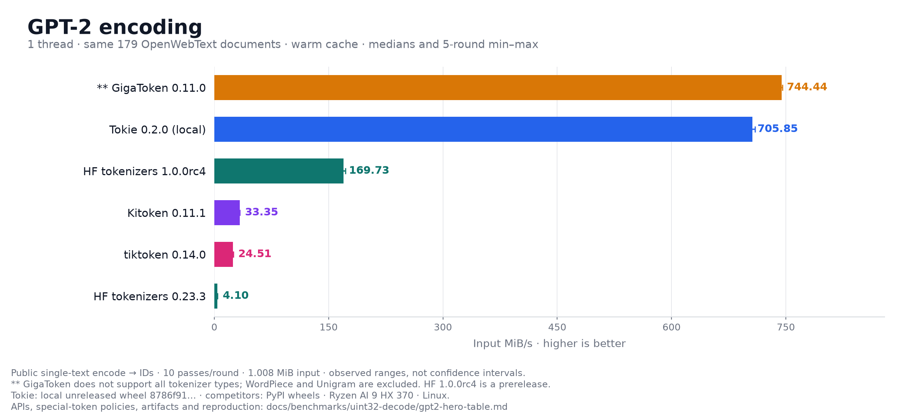
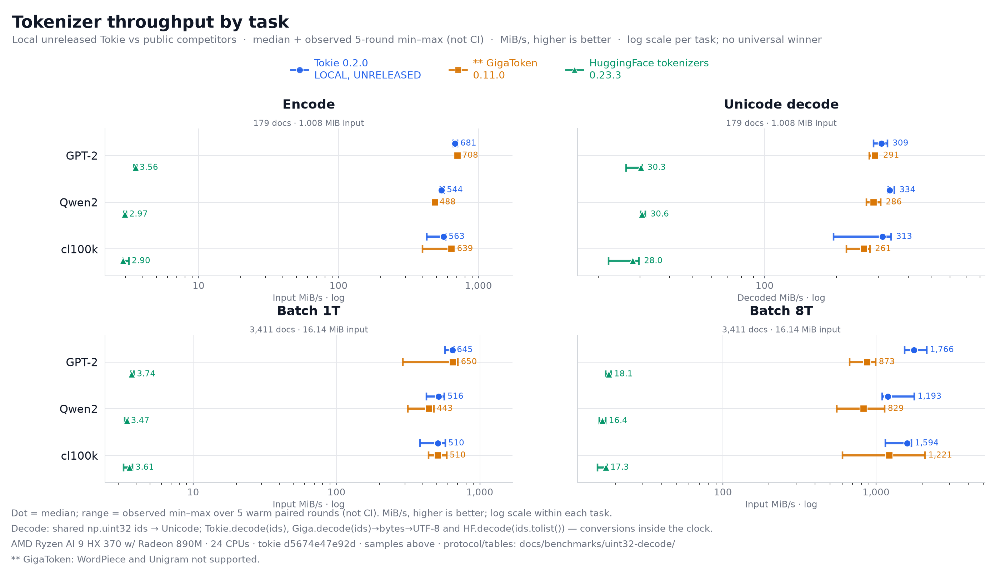
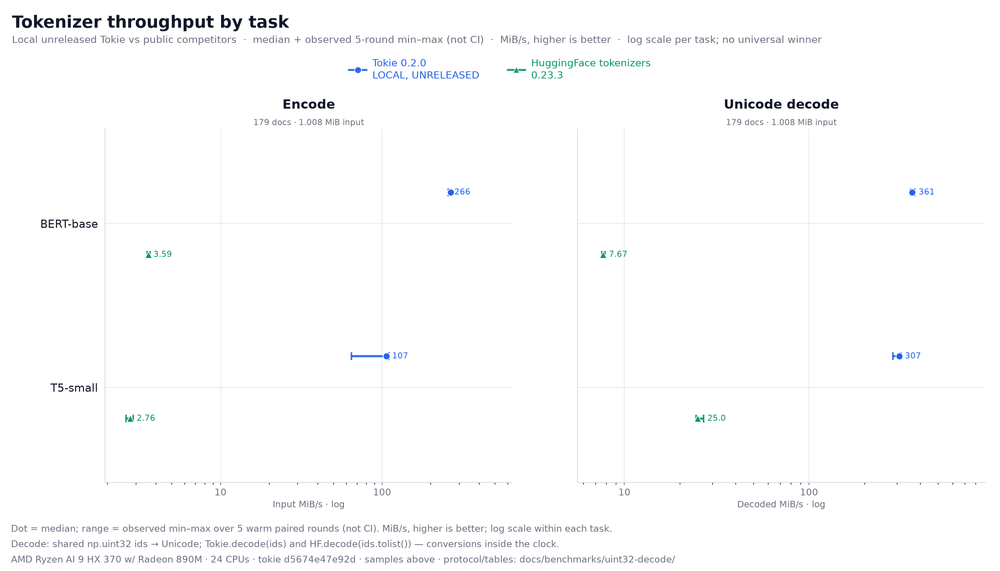

<div align="center">


# tokie

[](https://crates.io/crates/tokie)
[](https://pypi.org/project/tokie/)
[](https://crates.io/crates/tokie)
[](https://pypi.org/project/tokie/)
[](LICENSE-MIT)
[](https://docs.rs/tokie)
[](https://github.com/feyninc/tokie)

*Up to 190× faster encoding than Hugging Face. [100% accurate](#verified-tokenizers). Written in Rust.*

[Install](#install) •
[Quick start](#quick-start) •
[Examples](#examples) •
[Benchmarks](#benchmarks) •
[Why tokie?](#why-tokie)

</div>

tokie is a Rust tokenizer library with Python bindings. It loads a Hugging Face `tokenizer.json` and implements BPE, WordPiece, SentencePiece, and Unigram. The token ids match Hugging Face tokenizers for the supported models listed below. See [Benchmarks](#benchmarks) for the latest warm comparisons, including Hugging Face tokenizers 0.23.3 and 1.0.0rc4, Kitoken, tiktoken, and GigaToken.



*GPT-2 encode, one thread, warm cache, 179 OpenWebText documents. Local unreleased tokie; public GigaToken, Hugging Face 0.23.3 and 1.0.0rc4, Kitoken, and tiktoken. Separate run from the detailed charts below. \*\* GigaToken does not support all tokenizer types; WordPiece and Unigram are excluded.*

## Install

### Python

```bash
pip install -U tokie
```

The Python package is 0.3.0. Add a floor with `pip install "tokie>=0.3.0"` when a resolver needs one. `decode` and `decode_bytes` take NumPy arrays; Python 0.2.0 also accepted lists. The examples below pass arrays.

### Rust

```toml
[dependencies]
tokie = "0.2"
```

These docs describe Python 0.3.0 and Rust 0.2.0. Python 0.3.0 requires arrays for `decode`; Python 0.2.0 also accepted lists. See [the decode input note](docs/RELEASE_NOTE_DECODE_UINT32.md) and the [Python 0.3.0 release notes](docs/PYTHON_RELEASE_0_3.md). For the Rust 0.1.4 to 0.2 changes, see [API changes in 0.2](docs/API_CHANGES_0_2.md).

Coming from Hugging Face `tokenizers`? See the [migration guide](docs/MIGRATION.md).

## Quick start

### Python

```python
import tokie

tokenizer = tokie.Tokenizer.from_pretrained("google-bert/bert-base-uncased")

ids = tokenizer.encode("Hello, world!")
print(ids.tolist())

plus = tokenizer.encode_plus("Hello, world!")
print(plus.tolist())
print(tokenizer.encode_plus("Hello", pair="world", truncate=True, pad=True, max_len=8).tolist())

print(tokenizer.decode(plus, skip=True))

flat, ends = tokenizer.batch(["Hello!", "World"])
print(tokenizer.count_tokens("Hello, world!"))
print(tokenizer.count_tokens_batch(["Hello!", "World"]))
```

`encode` returns a `uint32` array and leaves the template off. `encode_plus` writes the parsed template, so BERT's single sequence is `[CLS]`, the ids, `[SEP]`. `pair` uses the pair template. `truncate` and `pad` share `max_len`, and that length counts the template ids; truncation drops from the right, longest sequence first, and padding is fixed on the right. `batch` returns one id array and `ends[i]`, the cumulative id count after text `i`. `count_tokens` returns the length `encode` would append. `count_tokens_batch` returns one length per text. Both leave the template off. Python returns NumPy arrays, not 0.1.4 `Encoding` objects; there is no `.ids`. Use `.tolist()` only to print or assert. `decode` and `decode_bytes` take a one-dimensional native `uint32` array directly, such as `plus` or `flat[start:end]`; do not pass `.tolist()`. Lists, tuples, and arrays of another dtype are rejected.

### Rust

```rust
use tokie::{Plus, Specials, Tokenizer};

let mut tokenizer = Tokenizer::pretrained("google-bert/bert-base-uncased")?;
let mut ids = Vec::new();
tokenizer.encode("Hello, world!", &mut ids)?;

ids.clear();
tokenizer.encode_plus("Hello, world!", &mut ids)?;
tokenizer.encode_plus(Plus::new("Hello").pair("world").truncate(8).pad(8), &mut ids)?;

let mut text = String::new();
tokenizer.decode(&ids, &mut text, Specials::Skip)?;

let n = tokenizer.count_tokens("Hello, world!")?;
let lengths = tokenizer.count_tokens_batch(&["Hello!", "World"])?;
```

`encode` and `encode_plus` append into the `Vec` the caller owns. Clear it to start a new sequence. `count_tokens` and `count_tokens_batch` write ids into a buffer on the tokenizer and return the lengths. They leave the template off.

## Examples

### Batch

```python
tokenizer.threads(4)
flat, ends = tokenizer.batch(["Short text", "A much longer piece of text"])
```

```rust
tokenizer.threads(4);
let lines = ["Short text", "A much longer piece of text"];
let mut ids = Vec::new();
let mut ends = Vec::new();
tokenizer.batch(&lines, &mut ids, &mut ends)?;
```

Text `i` is `ids[prev..ends[i]]`. `ends[i]` is `ids.len()` after that text.

### Vocabulary

```python
tokenizer.id("[SEP]")
tokenizer.token(101)
print(tokenizer.vocab_size)                          # highest id + 1
print(tokenizer.get_vocab())                         # raw token -> id
print(tokenizer.pad_token_id)                        # [PAD] then <pad>
print(tokenizer.num_special_tokens_to_add(is_pair=False))
```

```rust
tokenizer.id("[SEP]");
tokenizer.token(101);
let size = tokenizer.vocab_size();
let vocab = tokenizer.get_vocab();
let pad = tokenizer.pad_token_id();
let n = tokenizer.num_special_tokens_to_add(false);
```

`token`, `id`, and `get_vocab` use the raw vocab spelling. `vocab_size` is the highest id plus one, so it can include gaps and added ids; `get_vocab` may have fewer entries. `pad_token_id` looks up `[PAD]`, then `<pad>`, and nothing else.

### Save and load a `.tokie` file

```python
tokenizer.save("model.tokie")
again = tokie.Tokenizer.open("model.tokie")
```

```rust
tokenizer.save("model.tokie")?;
let mut again = Tokenizer::open("model.tokie")?;
```

`from_pretrained` in Python and `from_pretrained`/`pretrained` in Rust open exactly one `.tokie` file from the repo, whatever its name. A repo with no `.tokie` file is parsed from `tokenizer.json`; several `.tokie` files is an error. There is no runtime `.tkz` fallback: a genuine legacy `TOKI` image is refused by magic, not by filename, while a JSON file merely named `.tkz` is parsed as JSON. `from_json(path)` and `from_file(path)` are path aliases for `open`, and `to_file` is an alias for `save` in Rust. Legacy 0.1.4 binaries cannot read a `.tokie` file: rebuild from `tokenizer.json` with the new code, because renaming a `.tkz` file is not enough.

### Decode input

`decode` and `decode_bytes` take a one-dimensional native-endian NumPy `uint32` array. The array must be C-contiguous and aligned. Empty, read-only, and contiguous slice arrays are accepted. Pass `encode`, `encode_plus`, or a slice of `batch`'s flat ids directly. For ids already in a Python list, convert explicitly with `numpy.asarray(values, dtype=numpy.uint32)`; there is no implicit cast or fallback. `.tolist()` is for printing and assertions, not for passing to decode. `batch`'s `ends` array is `uint64`; it is not decode input.

```python
ids = tokenizer.encode("Hello")
print(tokenizer.decode(ids))
print(tokenizer.decode_bytes(ids, skip=True))

flat, ends = tokenizer.batch(["Hello", "world"])
print(tokenizer.decode(flat[: ends[0]]))  # first document
```

Lists, tuples, bytes, memoryview, other dtypes, other ranks, and foreign byte order raise `TypeError`. Non-contiguous or unaligned non-empty arrays raise `ValueError`. Gap and unknown ids, including `2**32 - 1`, still raise `tokie.TokieError`. These rules are the Python 0.3.0 contract; 0.2.0 also accepted lists. The [current benchmark](docs/BENCHMARK_UINT32_DECODE.md) was measured with the pre-version-bump development wheel, not the released package, and records the source branch snapshot separately from the wheel artifact.

## Benchmarks

Python 3.12, AMD Ryzen AI 9 HX 370, Linux. Warm-cache medians over five alternating rounds with the library order rotated. Single-document encode and Unicode decode use 179 OpenWebText documents (1.008 MiB); batch uses 3,411 documents (16.14 MiB) at one and eight threads. The tokie series is a **local unreleased 0.2.0 wheel** (sha256 `8786f91b1aed3acbac9d8090234e55f0400f829da6ea8a2817bcd460332a1d85`); the report records the source branch snapshot separately. Its version metadata says 0.2.0, but it is not on PyPI. The benchmarks use that pre-version-bump development wheel: the binding implementation is the same, the artifact and version stay as measured, and there was no retiming for the release. GigaToken 0.11.0 and Hugging Face `tokenizers` 0.23.3 are public wheels. The detailed charts below use those three; the GPT-2 six-library chart above adds HF 1.0.0rc4, Kitoken 0.11.1, and tiktoken 0.14.0 in a separate run.

The clocks cover each library's public call and output, not an isolated kernel. Encode includes id materialization. Decode decodes the same contiguous NumPy `uint32` ids to Unicode; GigaToken's UTF-8 decode and Hugging Face's `ids.tolist()` conversion are inside the clock. Batch includes tokie's flat ids plus ends, GigaToken's Awkward array, and Hugging Face's list of `Encoding.ids`. These are end-to-end API costs. Ranges are min–max over the five rounds, not confidence intervals.



On the recorded warm runs, encode is close on GPT-2, with overlapping ranges and no reliable winner. Tokie is clearly ahead on Qwen2 within this run. cl100k encode is uncertain because both ranges are wide and overlap. Unicode decode favors tokie on Qwen2; GPT-2 and cl100k ranges overlap, so no winner is claimed. Eight-thread batch is strongly ahead for tokie on GPT-2, a small-overlap uncertainty on Qwen2, and noisy/uncertain on cl100k. Hugging Face is much slower on every task. These are one host and one corpus slice, not a universal ranking or a regression proof.

BERT-base and T5-small ran against Hugging Face only, because GigaToken does not support WordPiece or Unigram; this is not a zero-throughput GigaToken result.



The new decode measurement is **Unicode text**, not the bytes returned by the old 0.2.0 decode benchmark. Do not combine the two decode tables or read their ratios as a like-for-like comparison.

Full method, per-model ranges, validation, artifact hashes, and limits: [current benchmark report](docs/BENCHMARK_UINT32_DECODE.md). Generated tables are authoritative for every number: [tables.md](docs/benchmarks/uint32-decode/tables.md). Raw data: [1-thread](docs/benchmarks/uint32-decode/results-1t.json), [8-thread batch](docs/benchmarks/uint32-decode/results-8t.json), [HF-only](docs/benchmarks/uint32-decode/results-hf-only.json). Reproduction commands: [run-commands.txt](docs/benchmarks/uint32-decode/run-commands.txt).

### Historical 0.2.0 benchmark

The prior GigaToken-only charts and tables were measured with the **published** 0.2.0 wheel and remain unchanged as a historical record in [the published 0.2.0 report](docs/PUBLISHED_BENCHMARK_0_2.md) and the `assets/benchmark_published_*` files. They are not the active benchmark. For previous-release engineering evidence, see [docs/BENCHMARK_AFTER.md](docs/BENCHMARK_AFTER.md).

## Verified tokenizers

A passing tokenizer is tested against the Hugging Face tokenizer on 1 MB of [enwik8](https://mattmahoney.net/dc/textdata.html), about 300,000 tokens, in [CI](https://github.com/feyninc/tokie/actions/workflows/tokenizer-accuracy.yml). Pass means every token matches. Not supported means tokie 0.2 refuses the file.

The full matrix is in [docs/TOKENIZERS.md](docs/TOKENIZERS.md).

<details>
<summary>Full accuracy table, 75 models</summary>

| Model | Type | Status |
|-------|------|--------|
| [GPT-2](https://huggingface.co/tokiers/gpt2) | BPE | Pass |
| [cl100k](https://huggingface.co/tokiers/cl100k) | BPE | Pass, compared with tiktoken-rs |
| [o200k](https://huggingface.co/tokiers/o200k) | BPE | Pass, compared with tiktoken-rs |
| [RoBERTa](https://huggingface.co/tokiers/roberta-base) | BPE | Pass |
| [Phi-2](https://huggingface.co/tokiers/phi-2) | BPE | Pass |
| [Phi-3 Mini](https://huggingface.co/tokiers/Phi-3-mini-4k-instruct) | BPE | Pass |
| [ModernBERT](https://huggingface.co/tokiers/ModernBERT-base) | BPE | Pass |
| [CodeLlama 7B](https://huggingface.co/tokiers/CodeLlama-7b-hf) | BPE | Pass |
| [DeepSeek-V3](https://huggingface.co/tokiers/DeepSeek-V3) | BPE | Pass |
| [DeepSeek-R1](https://huggingface.co/tokiers/DeepSeek-R1) | BPE | Pass |
| [Gemma 2 2B](https://huggingface.co/tokiers/gemma-2-2b) | SentencePiece BPE | Not supported, splits on a space |
| [Gemma 3 4B](https://huggingface.co/tokiers/gemma-3-4b-it) | SentencePiece BPE | Not supported, splits on a space |
| [Llama 3.2 1B](https://huggingface.co/tokiers/Llama-3.2-1B) | BPE | Pass |
| [Llama 4 Scout](https://huggingface.co/tokiers/Llama-4-Scout-17B-16E) | BPE | Pass |
| [Mistral 7B](https://huggingface.co/tokiers/Mistral-7B-v0.1) | BPE | Not supported, metaspace prepend is first |
| [Mistral Nemo](https://huggingface.co/tokiers/Mistral-Nemo-Base-2407) | BPE | Pass |
| [Mixtral 8x7B](https://huggingface.co/tokiers/Mixtral-8x7B-v0.1) | BPE | Pass |
| [NV-Embed-v2](https://huggingface.co/tokiers/NV-Embed-v2) | SentencePiece BPE | Pass |
| [Qwen2 7B](https://huggingface.co/tokiers/Qwen2-7B) | BPE | Pass |
| [Qwen3 Embed 0.6B](https://huggingface.co/tokiers/Qwen3-Embedding-0.6B) | BPE | Pass |
| [Qwen3 Embed 4B](https://huggingface.co/tokiers/Qwen3-Embedding-4B) | BPE | Pass |
| [Qwen3 Embed 8B](https://huggingface.co/tokiers/Qwen3-Embedding-8B) | BPE | Pass |
| [Qwen3 0.6B](https://huggingface.co/tokiers/Qwen3-0.6B) | BPE | Pass |
| [Qwen3 8B](https://huggingface.co/tokiers/Qwen3-8B) | BPE | Pass |
| [Qwen3 Coder 30B](https://huggingface.co/tokiers/Qwen3-Coder-30B-A3B-Instruct) | BPE | Pass |
| [Qwen3.5 0.8B](https://huggingface.co/tokiers/Qwen3.5-0.8B) | BPE | Pass |
| [Qwen3.5 4B](https://huggingface.co/tokiers/Qwen3.5-4B) | BPE | Pass |
| [SmolLM2 135M](https://huggingface.co/tokiers/SmolLM2-135M) | BPE | Pass |
| [StableLM 2 1.6B](https://huggingface.co/tokiers/stablelm-2-1_6b) | BPE | Pass |
| [Nomic Embed v1](https://huggingface.co/tokiers/nomic-embed-text-v1) | WordPiece | Pass |
| [BERT base](https://huggingface.co/tokiers/bert-base-uncased) | WordPiece | Pass |
| [all-MiniLM-L6-v2](https://huggingface.co/tokiers/all-MiniLM-L6-v2) | WordPiece | Pass |
| [all-MiniLM-L12-v2](https://huggingface.co/tokiers/all-MiniLM-L12-v2) | WordPiece | Pass |
| [all-mpnet-base-v2](https://huggingface.co/tokiers/all-mpnet-base-v2) | WordPiece | Pass |
| [BGE base en v1.5](https://huggingface.co/tokiers/bge-base-en-v1.5) | WordPiece | Pass |
| [BGE large en v1.5](https://huggingface.co/tokiers/bge-large-en-v1.5) | WordPiece | Pass |
| [BGE small en v1.5](https://huggingface.co/tokiers/bge-small-en-v1.5) | WordPiece | Pass |
| [BGE en ICL](https://huggingface.co/tokiers/bge-en-icl) | BPE | Pass |
| [BGE M3](https://huggingface.co/tokiers/bge-m3) | SentencePiece BPE | Not supported, regex replace |
| [E5 base v2](https://huggingface.co/tokiers/e5-base-v2) | WordPiece | Pass |
| [E5 large v2](https://huggingface.co/tokiers/e5-large-v2) | WordPiece | Pass |
| [E5 small v2](https://huggingface.co/tokiers/e5-small-v2) | WordPiece | Pass |
| [GTE base](https://huggingface.co/tokiers/gte-base) | WordPiece | Pass |
| [GTE large](https://huggingface.co/tokiers/gte-large) | WordPiece | Pass |
| [GTE small](https://huggingface.co/tokiers/gte-small) | WordPiece | Pass |
| [GTE Qwen2 7B](https://huggingface.co/tokiers/gte-Qwen2-7B-instruct) | BPE | Pass |
| [MS MARCO MiniLM L-4](https://huggingface.co/tokiers/ms-marco-MiniLM-L-4-v2) | WordPiece | Pass |
| [MS MARCO MiniLM L-6](https://huggingface.co/tokiers/ms-marco-MiniLM-L-6-v2) | WordPiece | Pass |
| [mxbai embed large v1](https://huggingface.co/tokiers/mxbai-embed-large-v1) | WordPiece | Pass |
| [mxbai embed 2d large v1](https://huggingface.co/tokiers/mxbai-embed-2d-large-v1) | WordPiece | Pass |
| [mxbai embed xsmall v1](https://huggingface.co/tokiers/mxbai-embed-xsmall-v1) | WordPiece | Pass |
| [deepset mxbai embed de large](https://huggingface.co/tokiers/deepset-mxbai-embed-de-large-v1) | Unigram | Pass |
| [Jina v2 base en](https://huggingface.co/tokiers/jina-embeddings-v2-base-en) | BPE | Pass |
| [Jina v2 base code](https://huggingface.co/tokiers/jina-embeddings-v2-base-code) | BPE | Pass |
| [Jina v3](https://huggingface.co/tokiers/jina-embeddings-v3) | Unigram | Pass |
| [Jina v4](https://huggingface.co/tokiers/jina-embeddings-v4) | BPE | Pass |
| [Cohere embed english v3](https://huggingface.co/tokiers/Cohere-embed-english-v3.0) | BPE | Pass |
| [Cohere embed english light v3](https://huggingface.co/tokiers/Cohere-embed-english-light-v3.0) | BPE | Pass |
| [Cohere embed multilingual v3](https://huggingface.co/tokiers/Cohere-embed-multilingual-v3.0) | Unigram | Pass |
| [Cohere embed multilingual light v3](https://huggingface.co/tokiers/Cohere-embed-multilingual-light-v3.0) | Unigram | Pass |
| [Voyage 3](https://huggingface.co/tokiers/voyage-3) | BPE | Pass |
| [Voyage 3 large](https://huggingface.co/tokiers/voyage-3-large) | BPE | Pass |
| [Voyage 3 lite](https://huggingface.co/tokiers/voyage-3-lite) | BPE | Pass |
| [Voyage 3.5](https://huggingface.co/tokiers/voyage-3.5) | BPE | Pass |
| [Voyage 3.5 lite](https://huggingface.co/tokiers/voyage-3.5-lite) | BPE | Pass |
| [Voyage Code 2](https://huggingface.co/tokiers/voyage-code-2) | BPE | Pass |
| [Voyage Code 3](https://huggingface.co/tokiers/voyage-code-3) | BPE | Pass |
| [Voyage Finance 2](https://huggingface.co/tokiers/voyage-finance-2) | BPE | Pass |
| [Voyage Law 2](https://huggingface.co/tokiers/voyage-law-2) | BPE | Pass |
| [Voyage Multilingual 2](https://huggingface.co/tokiers/voyage-multilingual-2) | BPE | Pass |
| [Voyage Multimodal 3](https://huggingface.co/tokiers/voyage-multimodal-3) | BPE | Pass |
| [Snowflake Arctic Embed v2](https://huggingface.co/tokiers/snowflake-arctic-embed-l-v2.0) | SentencePiece BPE | Not supported, regex replace |
| [potion multilingual 128M](https://huggingface.co/tokiers/potion-multilingual-128M) | Unigram | Not supported, regex replace |
| [T5 base](https://huggingface.co/tokiers/t5-base) | Unigram | Pass |
| [XLM-RoBERTa](https://huggingface.co/tokiers/xlm-roberta-base) | SentencePiece BPE | Pass |

</details>

**69 pass. 6 are not supported, out of 75 listed.** The passing tokenizers' ids match Hugging Face tokenizers.

## Why tokie?

When I started building [Chonkie](https://github.com/chonkie-inc/chonkie), tokenization took longer than chunking.

Each pretokenization pattern has its own parser: GPT-2, cl100k, o200k, and BERT. The parser uses that pattern's character classes and does not run a general regex engine. Since 0.1.0 those parsers are a SIMD mask scanner: they classify 64-byte blocks into character-class bitmasks and take piece boundaries from the masks.

No single library loaded every Hugging Face tokenizer. I tried [AutoTikTokenizer](https://github.com/bhavnick/autotiktokenizer) and expected tiktoken's BPE to cover them. It does not. Tiktoken-style models need backtracking BPE. A merge order that is not topological needs a heap. SentencePiece needs a radix heap. WordPiece and Unigram each need their own encoder.

Tokenization runs in parallel when the split keeps token boundaries. [chunk](https://github.com/chonkie-inc/chunk) splits the text on those boundaries. Each core encodes one chunk, and the ids are concatenated. The speedup depends on text size and thread count; the current batch checks cover the 16.14 MiB sample at one and eight threads, and the historical 0.2.0 report has an additional smaller eight-thread sample.

0.2 stores the normalized vocabulary and the loaded piece list in a `.tokie` file, so load does not rebuild them. `tokenizer.json` is parsed and validated and the vocabulary tables are built; for a large vocabulary that build is slow. A `.tokie` file is a different format from legacy `.tkz`: a genuine legacy `TOKI` image is refused by magic, not by extension, and legacy 0.1.4 binaries cannot read `.tokie`. Rebuild from `tokenizer.json`; renaming is not enough. The current benchmark excludes token load time: it measures warm calls after one warmup pass, and the [report](docs/BENCHMARK_UINT32_DECODE.md) does not retime cold starts. The historical [published 0.2.0 report](docs/PUBLISHED_BENCHMARK_0_2.md) has the older cold first-call observations.

## Acknowledgements

tokie uses ideas from [Hugging Face tokenizers](https://github.com/huggingface/tokenizers), [tiktoken](https://github.com/openai/tiktoken), and [GitHub's rust-gems](https://github.com/github/rust-gems) for backtracking BPE via Aho-Corasick. It also uses [chunk](https://github.com/chonkie-inc/chunk) for SIMD text splitting, and [gigatoken](https://github.com/marcelroed/gigatoken). Gigatoken's piece cache, mask-scanner pretokenization, and benchmarks shaped the 0.1.0 hot path.

## Citation

If you use tokie in your research, please cite it as follows:

```bibtex
@software{tokie2025,
  author = {Minhas, Bhavnick},
  title = {tokie: Fast, correct tokenizer library for every Hugging Face model},
  year = {2025},
  publisher = {GitHub},
  howpublished = {\url{https://github.com/feyninc/tokie}},
}
```
