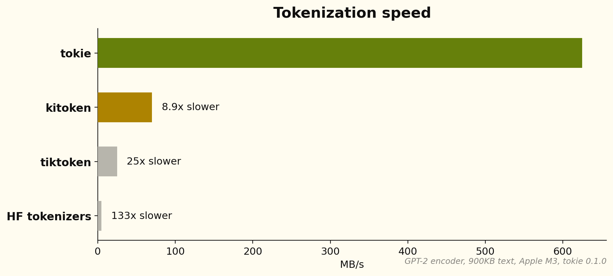
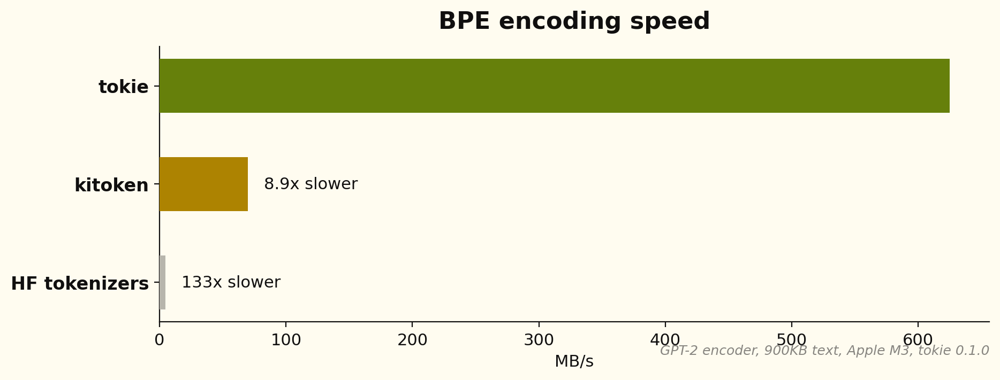
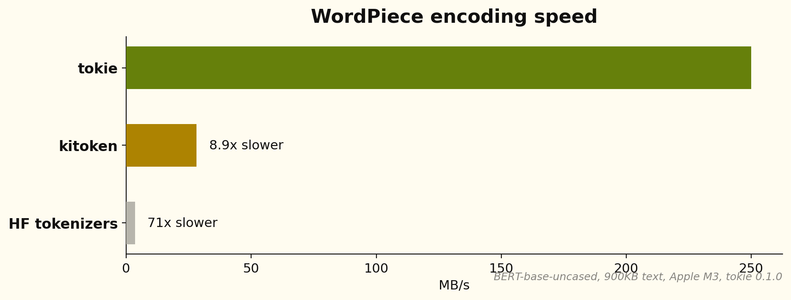
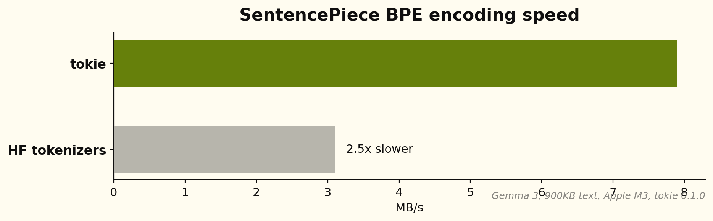
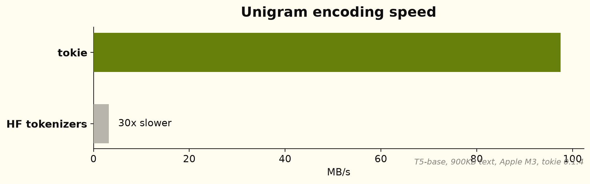
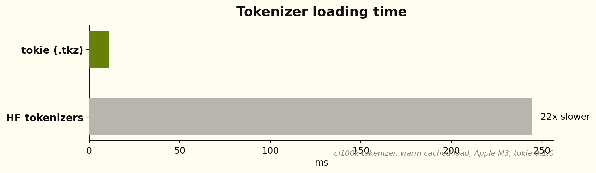

<div align="center">


# tokie

[](https://crates.io/crates/tokie)
[](https://pypi.org/project/tokie/)
[](https://crates.io/crates/tokie)
[](https://pypi.org/project/tokie/)
[](LICENSE-MIT)
[](https://docs.rs/tokie)
[](https://github.com/chonkie-inc/tokie)

*Historical 0.1.3 benchmark: 25 to 150 times faster than Hugging Face tokenizers, with the same token ids. 0.2 timings are pending.*

[Install](#install) •
[Quick start](#quick-start) •
[Examples](#examples) •
[Benchmarks](#benchmarks) •
[Why tokie?](#why-tokie)

</div>

> [!CAUTION]
> tokie is in its alpha stage and might produce mis-aligned output. Please report any issues you encounter.

tokie is a Rust tokenizer library with Python bindings. It loads a Hugging Face `tokenizer.json` and, in the historical 0.1.3 benchmark, encoded 25 to 150 times faster than Hugging Face tokenizers. It implements BPE, WordPiece, SentencePiece, and Unigram. The token ids match Hugging Face tokenizers. 0.2 has not been re-timed; see [Benchmarks](#benchmarks) and [docs/BENCHMARK_BASELINE.md](docs/BENCHMARK_BASELINE.md).



## Install

### Python

```bash
pip install tokie
```

### Rust

```toml
[dependencies]
tokie = "0.2"
```

This tree is the unreleased 0.2. crates.io and PyPI still serve 0.1.4, which does not have these calls. See [API changes in 0.2](docs/API_CHANGES_0_2.md).

Coming from Hugging Face `tokenizers`? See the [migration guide](docs/MIGRATION.md).

## Quick start

### Python

```python
import tokie

tokenizer = tokie.Tokenizer.from_pretrained("google-bert/bert-base-uncased")

ids = tokenizer.encode("Hello, world!")
print(ids.tolist())

plus = tokenizer.encode_plus("Hello, world!")
print(plus.tolist())
print(tokenizer.encode_plus("Hello", pair="world", truncate=True, pad=True, max_len=8).tolist())

print(tokenizer.decode(plus.tolist(), skip=True))

flat, ends = tokenizer.batch(["Hello!", "World"])
print(tokenizer.count_tokens("Hello, world!"))
print(tokenizer.count_tokens_batch(["Hello!", "World"]))
```

`encode` returns a `uint32` array and leaves the template off. `encode_plus` writes the parsed template, so BERT's single sequence is `[CLS]`, the ids, `[SEP]`. `pair` uses the pair template. `truncate` and `pad` share `max_len`, and that length counts the template ids; truncation drops from the right, longest sequence first, and padding is fixed on the right. `batch` returns one id array and `ends[i]`, the cumulative id count after text `i`. `count_tokens` returns the length `encode` would append. `count_tokens_batch` returns one length per text. Both leave the template off. Python returns NumPy arrays, not 0.1.4 `Encoding` objects; there is no `.ids`, so use `.tolist()`.

### Rust

```rust
use tokie::{Plus, Specials, Tokenizer};

let mut tokenizer = Tokenizer::pretrained("google-bert/bert-base-uncased")?;
let mut ids = Vec::new();
tokenizer.encode("Hello, world!", &mut ids)?;

ids.clear();
tokenizer.encode_plus("Hello, world!", &mut ids)?;
tokenizer.encode_plus(Plus::new("Hello").pair("world").truncate(8).pad(8), &mut ids)?;

let mut text = String::new();
tokenizer.decode(&ids, &mut text, Specials::Skip)?;

let n = tokenizer.count_tokens("Hello, world!")?;
let lengths = tokenizer.count_tokens_batch(&["Hello!", "World"])?;
```

`encode` and `encode_plus` append into the `Vec` the caller owns. Clear it to start a new sequence. `count_tokens` and `count_tokens_batch` write ids into a buffer on the tokenizer and return the lengths. They leave the template off.

## Examples

### Batch

```python
tokenizer.threads(4)
flat, ends = tokenizer.batch(["Short text", "A much longer piece of text"])
```

```rust
tokenizer.threads(4);
let lines = ["Short text", "A much longer piece of text"];
let mut ids = Vec::new();
let mut ends = Vec::new();
tokenizer.batch(&lines, &mut ids, &mut ends)?;
```

Text `i` is `ids[prev..ends[i]]`. `ends[i]` is `ids.len()` after that text.

### Vocabulary

```python
tokenizer.id("[SEP]")
tokenizer.token(101)
print(tokenizer.vocab_size)                          # highest id + 1
print(tokenizer.get_vocab())                         # raw token -> id
print(tokenizer.pad_token_id)                        # [PAD] then <pad>
print(tokenizer.num_special_tokens_to_add(is_pair=False))
```

```rust
tokenizer.id("[SEP]");
tokenizer.token(101);
let size = tokenizer.vocab_size();
let vocab = tokenizer.get_vocab();
let pad = tokenizer.pad_token_id();
let n = tokenizer.num_special_tokens_to_add(false);
```

`token`, `id`, and `get_vocab` use the raw vocab spelling. `vocab_size` is the highest id plus one, so it can include gaps and added ids; `get_vocab` may have fewer entries. `pad_token_id` looks up `[PAD]`, then `<pad>`, and nothing else.

### Save and load a `.tokie` file

```python
tokenizer.save("model.tokie")
again = tokie.Tokenizer.open("model.tokie")
```

```rust
tokenizer.save("model.tokie")?;
let mut again = Tokenizer::open("model.tokie")?;
```

`from_pretrained` in Python and `from_pretrained`/`pretrained` in Rust open exactly one `.tokie` file from the repo, whatever its name. A repo with no `.tokie` file is parsed from `tokenizer.json`; several `.tokie` files is an error. There is no runtime `.tkz` fallback: a genuine legacy `TOKI` image is refused by magic, not by filename, while a JSON file merely named `.tkz` is parsed as JSON. `from_json(path)` and `from_file(path)` are path aliases for `open`, and `to_file` is an alias for `save` in Rust. Legacy 0.1.4 binaries cannot read a `.tokie` file: rebuild from `tokenizer.json` with the new code, because renaming a `.tkz` file is not enough.

## Benchmarks

All numbers in this section are historical measurements from the 0.1.3/0.1.4 `.tkz` artifact on an Apple M3. They are not 0.2 `.tokie` measurements. The before-state baseline is [docs/BENCHMARK_BASELINE.md](docs/BENCHMARK_BASELINE.md); the final 0.2 report is [docs/BENCHMARK_AFTER.md](docs/BENCHMARK_AFTER.md), where the strict performance criterion is uncertified/partial. The ids match Hugging Face tokenizers.

### BPE encoding (GPT-2, Llama, Qwen, ModernBERT)

For tiktoken-style BPE, tokie uses a backtracking encoder on an Aho-Corasick automaton. It takes a greedy longest match in O(n), and it backtracks only when two adjacent tokens are not a valid pair. It does not merge one byte pair at a time. Pretokenization is the SIMD mask scanner in [pretokie](https://crates.io/crates/pretokie). That scanner classifies 64-byte blocks into piece-boundary bitmasks and runs above 1 GB/s per core. A repeated piece hits a per-worker cache instead of running BPE again. Work stealing splits the text so every core has a chunk. On one string this is 39 to 154 times faster than Hugging Face tokenizers.



### WordPiece (BERT, MiniLM, BGE, GTE)

WordPiece searches a vocabulary trie for the longest prefix. tokie stores that trie as a Double-Array trie and looks it up in O(n), with a BERT pretokenizer. On BERT this is 25 to 71 times faster than Hugging Face tokenizers, and the ids match.



### SentencePiece BPE and Unigram (Gemma, XLM-R, T5)

SentencePiece BPE merges in an order that is not topological. tokie uses a radix heap. Insert and pop are O(1) amortized because a later BPE rank is never smaller. On Gemma 3 this is 2 to 3 times faster than Hugging Face tokenizers.

Unigram models such as T5, XLM-RoBERTa, and ALBERT run Viterbi on each metaspace-delimited word and store the frequent units. Encoding one string is about 4 times faster than whole-string Viterbi. Batch encoding is about 3 times faster. The ids match. A vocabulary with a metaspace inside a token uses whole-string Viterbi.





### Python benchmarks

All results on Apple M3, single-string encode, median of 10 runs.

#### tokie vs Hugging Face tokenizers

| Model | Text size | tokie | Hugging Face | Speedup |
|-------|-----------|-------|---------------|-------|
| BERT | 45 KB | 0.38 ms | 9.6 ms | **25x** |
| BERT | 900 KB | 3.60 ms | 257 ms | **71x** |
| GPT-2 | 45 KB | 0.13 ms | 8.6 ms | **65x** |
| GPT-2 | 900 KB | 1.44 ms | 191 ms | **133x** |
| Llama 3 | 45 KB | 0.22 ms | 8.6 ms | **39x** |
| Llama 3 | 900 KB | 2.49 ms | 195 ms | **78x** |
| Qwen 3 | 45 KB | 0.13 ms | 9.1 ms | **68x** |
| Qwen 3 | 900 KB | 1.36 ms | 210 ms | **154x** |
| ModernBERT | 45 KB | 0.15 ms | 9.3 ms | **62x** |
| ModernBERT | 900 KB | 1.42 ms | 211 ms | **149x** |
| Gemma 3 | 45 KB | 4.54 ms | 9.7 ms | **2x** |
| Gemma 3 | 900 KB | 114 ms | 289 ms | **3x** |

#### tokie vs tiktoken (OpenAI models)

| Model | Text size | tokie | tiktoken | Speedup |
|-------|-----------|-------|----------|---------|
| cl100k (GPT-4) | 45 KB | 0.13 ms | 2.12 ms | **17x** |
| cl100k (GPT-4) | 900 KB | 1.28 ms | 42.3 ms | **33x** |
| o200k (GPT-4o) | 45 KB | 0.16 ms | 3.57 ms | **22x** |
| o200k (GPT-4o) | 900 KB | 1.66 ms | 70.7 ms | **42x** |

The ids match on every model in these tables. In that historical benchmark, batch encoding was 17 to 36 times faster than Hugging Face tokenizers. 0.2 `batch` returns one contiguous NumPy id array plus cumulative `ends`; the old `encode_batch_flat` name is gone.

### Tokenizer loading (historical 0.1.4 `.tkz` measurements)

Loading `tokenizer.json` parses the JSON, builds the vocabulary, and, for BPE, builds the tables the encoder reads. The 0.2 `.tokie` file stores the normalized tables and the loaded piece list, so a warm load is deserialization; ids learned by later `encode` calls stay in the piece cache and are not written by `save`. `from_pretrained`/`pretrained` opens exactly one `.tokie` file from the repo, whatever its name; a repo with none is parsed from `tokenizer.json`. Several `.tokie` files is an error. There is no runtime `.tkz` fallback: a genuine legacy `TOKI` image is refused by magic, not by filename, while a JSON file merely named `.tkz` is parsed as JSON. The load times below are historical 0.1.4 `.tkz` measurements, not 0.2 `.tokie` measurements.

| Model | tokie | Hugging Face | Speedup |
|-------|-------|---------------|---------|
| BERT | 2.8 ms | 123 ms | **44x** |
| GPT-2 | 6.2 ms | 151 ms | **24x** |
| Llama 3.2 | 10.6 ms | 261 ms | **25x** |
| cl100k | 11.1 ms | 244 ms | **22x** |
| o200k | 23.2 ms | 310 ms | **13x** |

*These load times are historical 0.1.4 `.tkz` measurements. They are not 0.2 `.tokie` measurements.*



## Verified tokenizers

A passing tokenizer is tested against the Hugging Face tokenizer on 1 MB of [enwik8](https://mattmahoney.net/dc/textdata.html), about 300,000 tokens, in [CI](../../actions/workflows/tokenizer-accuracy.yml). Pass means every token matches. Not supported means tokie 0.2 refuses the file.

The full matrix is in [docs/TOKENIZERS.md](docs/TOKENIZERS.md).

<details>
<summary>Full accuracy table, 75 models</summary>

| Model | Type | Status |
|-------|------|--------|
| [GPT-2](https://huggingface.co/tokiers/gpt2) | BPE | Pass |
| [cl100k](https://huggingface.co/tokiers/cl100k) | BPE | Pass, compared with tiktoken-rs |
| [o200k](https://huggingface.co/tokiers/o200k) | BPE | Pass, compared with tiktoken-rs |
| [RoBERTa](https://huggingface.co/tokiers/roberta-base) | BPE | Pass |
| [Phi-2](https://huggingface.co/tokiers/phi-2) | BPE | Pass |
| [Phi-3 Mini](https://huggingface.co/tokiers/Phi-3-mini-4k-instruct) | BPE | Pass |
| [ModernBERT](https://huggingface.co/tokiers/ModernBERT-base) | BPE | Pass |
| [CodeLlama 7B](https://huggingface.co/tokiers/CodeLlama-7b-hf) | BPE | Pass |
| [DeepSeek-V3](https://huggingface.co/tokiers/DeepSeek-V3) | BPE | Pass |
| [DeepSeek-R1](https://huggingface.co/tokiers/DeepSeek-R1) | BPE | Pass |
| [Gemma 2 2B](https://huggingface.co/tokiers/gemma-2-2b) | SentencePiece BPE | Not supported, splits on a space |
| [Gemma 3 4B](https://huggingface.co/tokiers/gemma-3-4b-it) | SentencePiece BPE | Not supported, splits on a space |
| [Llama 3.2 1B](https://huggingface.co/tokiers/Llama-3.2-1B) | BPE | Pass |
| [Llama 4 Scout](https://huggingface.co/tokiers/Llama-4-Scout-17B-16E) | BPE | Pass |
| [Mistral 7B](https://huggingface.co/tokiers/Mistral-7B-v0.1) | BPE | Not supported, metaspace prepend is first |
| [Mistral Nemo](https://huggingface.co/tokiers/Mistral-Nemo-Base-2407) | BPE | Pass |
| [Mixtral 8x7B](https://huggingface.co/tokiers/Mixtral-8x7B-v0.1) | BPE | Pass |
| [NV-Embed-v2](https://huggingface.co/tokiers/NV-Embed-v2) | SentencePiece BPE | Pass |
| [Qwen2 7B](https://huggingface.co/tokiers/Qwen2-7B) | BPE | Pass |
| [Qwen3 Embed 0.6B](https://huggingface.co/tokiers/Qwen3-Embedding-0.6B) | BPE | Pass |
| [Qwen3 Embed 4B](https://huggingface.co/tokiers/Qwen3-Embedding-4B) | BPE | Pass |
| [Qwen3 Embed 8B](https://huggingface.co/tokiers/Qwen3-Embedding-8B) | BPE | Pass |
| [Qwen3 0.6B](https://huggingface.co/tokiers/Qwen3-0.6B) | BPE | Pass |
| [Qwen3 8B](https://huggingface.co/tokiers/Qwen3-8B) | BPE | Pass |
| [Qwen3 Coder 30B](https://huggingface.co/tokiers/Qwen3-Coder-30B-A3B-Instruct) | BPE | Pass |
| [Qwen3.5 0.8B](https://huggingface.co/tokiers/Qwen3.5-0.8B) | BPE | Pass |
| [Qwen3.5 4B](https://huggingface.co/tokiers/Qwen3.5-4B) | BPE | Pass |
| [SmolLM2 135M](https://huggingface.co/tokiers/SmolLM2-135M) | BPE | Pass |
| [StableLM 2 1.6B](https://huggingface.co/tokiers/stablelm-2-1_6b) | BPE | Pass |
| [Nomic Embed v1](https://huggingface.co/tokiers/nomic-embed-text-v1) | WordPiece | Pass |
| [BERT base](https://huggingface.co/tokiers/bert-base-uncased) | WordPiece | Pass |
| [all-MiniLM-L6-v2](https://huggingface.co/tokiers/all-MiniLM-L6-v2) | WordPiece | Pass |
| [all-MiniLM-L12-v2](https://huggingface.co/tokiers/all-MiniLM-L12-v2) | WordPiece | Pass |
| [all-mpnet-base-v2](https://huggingface.co/tokiers/all-mpnet-base-v2) | WordPiece | Pass |
| [BGE base en v1.5](https://huggingface.co/tokiers/bge-base-en-v1.5) | WordPiece | Pass |
| [BGE large en v1.5](https://huggingface.co/tokiers/bge-large-en-v1.5) | WordPiece | Pass |
| [BGE small en v1.5](https://huggingface.co/tokiers/bge-small-en-v1.5) | WordPiece | Pass |
| [BGE en ICL](https://huggingface.co/tokiers/bge-en-icl) | BPE | Pass |
| [BGE M3](https://huggingface.co/tokiers/bge-m3) | SentencePiece BPE | Not supported, regex replace |
| [E5 base v2](https://huggingface.co/tokiers/e5-base-v2) | WordPiece | Pass |
| [E5 large v2](https://huggingface.co/tokiers/e5-large-v2) | WordPiece | Pass |
| [E5 small v2](https://huggingface.co/tokiers/e5-small-v2) | WordPiece | Pass |
| [GTE base](https://huggingface.co/tokiers/gte-base) | WordPiece | Pass |
| [GTE large](https://huggingface.co/tokiers/gte-large) | WordPiece | Pass |
| [GTE small](https://huggingface.co/tokiers/gte-small) | WordPiece | Pass |
| [GTE Qwen2 7B](https://huggingface.co/tokiers/gte-Qwen2-7B-instruct) | BPE | Pass |
| [MS MARCO MiniLM L-4](https://huggingface.co/tokiers/ms-marco-MiniLM-L-4-v2) | WordPiece | Pass |
| [MS MARCO MiniLM L-6](https://huggingface.co/tokiers/ms-marco-MiniLM-L-6-v2) | WordPiece | Pass |
| [mxbai embed large v1](https://huggingface.co/tokiers/mxbai-embed-large-v1) | WordPiece | Pass |
| [mxbai embed 2d large v1](https://huggingface.co/tokiers/mxbai-embed-2d-large-v1) | WordPiece | Pass |
| [mxbai embed xsmall v1](https://huggingface.co/tokiers/mxbai-embed-xsmall-v1) | WordPiece | Pass |
| [deepset mxbai embed de large](https://huggingface.co/tokiers/deepset-mxbai-embed-de-large-v1) | Unigram | Pass |
| [Jina v2 base en](https://huggingface.co/tokiers/jina-embeddings-v2-base-en) | BPE | Pass |
| [Jina v2 base code](https://huggingface.co/tokiers/jina-embeddings-v2-base-code) | BPE | Pass |
| [Jina v3](https://huggingface.co/tokiers/jina-embeddings-v3) | Unigram | Pass |
| [Jina v4](https://huggingface.co/tokiers/jina-embeddings-v4) | BPE | Pass |
| [Cohere embed english v3](https://huggingface.co/tokiers/Cohere-embed-english-v3.0) | BPE | Pass |
| [Cohere embed english light v3](https://huggingface.co/tokiers/Cohere-embed-english-light-v3.0) | BPE | Pass |
| [Cohere embed multilingual v3](https://huggingface.co/tokiers/Cohere-embed-multilingual-v3.0) | Unigram | Pass |
| [Cohere embed multilingual light v3](https://huggingface.co/tokiers/Cohere-embed-multilingual-light-v3.0) | Unigram | Pass |
| [Voyage 3](https://huggingface.co/tokiers/voyage-3) | BPE | Pass |
| [Voyage 3 large](https://huggingface.co/tokiers/voyage-3-large) | BPE | Pass |
| [Voyage 3 lite](https://huggingface.co/tokiers/voyage-3-lite) | BPE | Pass |
| [Voyage 3.5](https://huggingface.co/tokiers/voyage-3.5) | BPE | Pass |
| [Voyage 3.5 lite](https://huggingface.co/tokiers/voyage-3.5-lite) | BPE | Pass |
| [Voyage Code 2](https://huggingface.co/tokiers/voyage-code-2) | BPE | Pass |
| [Voyage Code 3](https://huggingface.co/tokiers/voyage-code-3) | BPE | Pass |
| [Voyage Finance 2](https://huggingface.co/tokiers/voyage-finance-2) | BPE | Pass |
| [Voyage Law 2](https://huggingface.co/tokiers/voyage-law-2) | BPE | Pass |
| [Voyage Multilingual 2](https://huggingface.co/tokiers/voyage-multilingual-2) | BPE | Pass |
| [Voyage Multimodal 3](https://huggingface.co/tokiers/voyage-multimodal-3) | BPE | Pass |
| [Snowflake Arctic Embed v2](https://huggingface.co/tokiers/snowflake-arctic-embed-l-v2.0) | SentencePiece BPE | Not supported, regex replace |
| [potion multilingual 128M](https://huggingface.co/tokiers/potion-multilingual-128M) | Unigram | Not supported, regex replace |
| [T5 base](https://huggingface.co/tokiers/t5-base) | Unigram | Pass |
| [XLM-RoBERTa](https://huggingface.co/tokiers/xlm-roberta-base) | SentencePiece BPE | Pass |

</details>

**69 pass. 6 are not supported, out of 75 listed.** The passing tokenizers' ids match Hugging Face tokenizers.

## Why tokie?

When I started building [Chonkie](https://github.com/chonkie-inc/chonkie), tokenization took longer than chunking.

Each pretokenization pattern has its own parser: GPT-2, cl100k, o200k, and BERT. The parser uses that pattern's character classes and does not run a general regex engine. Since 0.1.0 those parsers are a SIMD mask scanner. They classify 64-byte blocks into character-class bitmasks and take piece boundaries from the masks. Pretokenization passes 1 GB/s per core, more than 20 times the reference regexes.

No single library loaded every Hugging Face tokenizer. I tried [AutoTikTokenizer](https://github.com/bhavnick/autotiktokenizer) and expected tiktoken's BPE to cover them. It does not. Tiktoken-style models need backtracking BPE. A merge order that is not topological needs a heap. SentencePiece needs a radix heap. WordPiece and Unigram each need their own encoder.

Tokenization runs in parallel when the split keeps token boundaries. [chunk](https://github.com/chonkie-inc/chunk) splits the text on those boundaries. Each core encodes one chunk, and the ids are concatenated. On 8 cores that is about 5 times faster.

0.2 stores the normalized vocabulary and the loaded piece list in a `.tokie` file, so load does not rebuild them. `tokenizer.json` is parsed and validated and the vocabulary tables are built; for a large vocabulary that build is slow. A `.tokie` file is a different format from legacy `.tkz`: a genuine legacy `TOKI` image is refused by magic, not by extension, and legacy 0.1.4 binaries cannot read `.tokie`. Rebuild from `tokenizer.json`; renaming is not enough. The load times quoted in the table above are historical 0.1.4 `.tkz` measurements, not 0.2 `.tokie` measurements.

## Acknowledgements

tokie uses ideas from [Hugging Face tokenizers](https://github.com/huggingface/tokenizers), [tiktoken](https://github.com/openai/tiktoken), and [GitHub's rust-gems](https://github.com/github/rust-gems) for backtracking BPE via Aho-Corasick. It also uses [chunk](https://github.com/chonkie-inc/chunk) for SIMD text splitting, and [gigatoken](https://github.com/marcelroed/gigatoken). Gigatoken's piece cache, mask-scanner pretokenization, and benchmarks shaped the 0.1.0 hot path.

## Citation

If you use tokie in your research, please cite it as follows:

```bibtex
@software{tokie2025,
  author = {Minhas, Bhavnick},
  title = {tokie: Fast, correct tokenizer library for every Hugging Face model},
  year = {2025},
  publisher = {GitHub},
  howpublished = {\url{https://github.com/chonkie-inc/tokie}},
}
```
